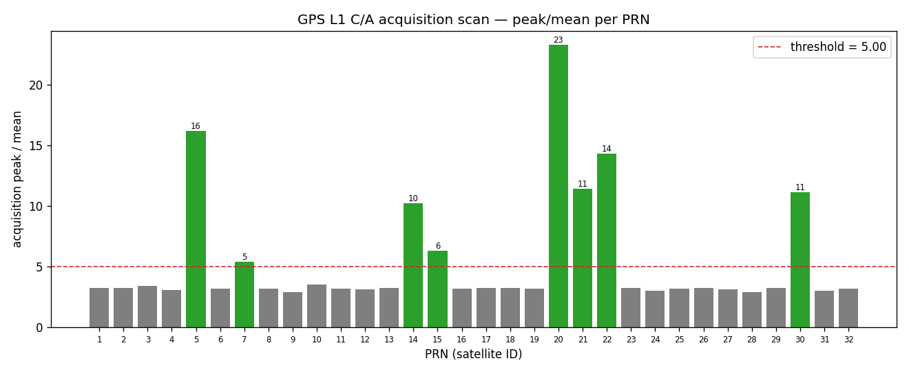

# Stage 02 — Acquisition (scanning the PRNs)

**Goal of this stage:** given a recording of raw GPS L1 IQ, find out **which
satellites are overhead** and get a first estimate of each one's **code phase**
and **Doppler**. In GPS terminology this is *acquisition*; informally it's
"scanning the PRNs."

This is the first real signal-processing step of the receiver. Everything after it
(tracking → decoding → positioning) needs the (PRN, code phase, Doppler) starting
points that acquisition produces.

---

## The concepts (short version)

### 1. What is a PRN?
Every GPS satellite transmits its own **1023-chip pseudo-random code** (the C/A
code) at 1.023 Mchip/s, so the code repeats every **1 ms**. "PRN" is the
satellite's ID (1–32) and selects which code it sends. The codes are **Gold
codes**: nearly uncorrelated with shifted copies of themselves (sharp peak when
aligned) and with each other (satellites don't drown each other out). All
satellites share the same 1575.42 MHz carrier and are separated *only* by their
codes — this is CDMA. (Generator: [`../common/ca_code.py`](../common/ca_code.py).)

### 2. Why acquisition is a 2-D search
For a given PRN we don't know two things:
- **Code phase** (0–1022 chips): where the satellite's code currently lines up
  inside the 1 ms window — set by the signal's travel time.
- **Doppler** (Hz): the carrier frequency offset. Satellite motion gives ±5 kHz;
  the HackRF's own oscillator adds up to ~±31 kHz at L1 (±20 ppm). Until we remove
  it, the code won't correlate.

So we search over a grid of **(code phase × Doppler)**. For each Doppler bin we
"wipe off" the carrier (multiply by `exp(-j2π·f·t)`) and correlate against the
local code replica. A sharp correlation peak says "this satellite is here, at this
code phase."

### 3. The FFT trick (parallel code-phase search)
Trying all 1023 code phases one at a time is slow. Circular correlation via the
FFT gives **all** code phases at once:
```
corr = IFFT( FFT(signal_1ms) · conj(FFT(code_1ms)) )
```
We do this per Doppler bin and **non-coherently accumulate** `|corr|²` over several
1 ms periods to lift weak satellites out of the noise.

### 4. Coherent vs non-coherent integration
- *Coherent* (summing the complex correlator) gives the best gain but is limited to
  <20 ms because the 50 bps navigation data flips the signal's sign every 20 ms,
  and any residual Doppler rotates the phase.
- *Non-coherent* (summing `|corr|²`) sidesteps both at a small SNR cost. We
  integrate **10 ms non-coherently** here — robust and good enough to *detect*.

### 5. The detection metric
We report **peak / mean** of the accumulated correlation surface. Pure noise gives
a ratio near the floor (~3 for 10 ms at 4 MSPS — the floor rises with the number of
correlation cells); a real satellite stands far above it. The default threshold is
`5.0`. **A threshold alone can be fooled** (see verification below).

---

## How to run

```bash
# default: scans recordings/capture.bin (int8, 4 MSPS, the bundled capture)
python 02_acquisition/scan_prns.py

# other recording / format / search settings
python 02_acquisition/scan_prns.py --iq path\to\file.dat --format complex64 \
    --fs 4e6 --dop-range 10000 --dop-step 250 --ms 10 --threshold 5.0
```
Outputs: a table on stdout, `scan_results.csv` (+ `scan_results.meta.json`: which
recording and settings produced it), and `scan_plot.png` (peak/mean per PRN with the
threshold line).

The search itself is in [`../bassanite/acquisition.py`](../bassanite/acquisition.py)
(`correlation_surface()`, `acquire_prn()`, `scan()`); `scan_prns.py` is its command
line. `acquire_prn(..., return_surface=True)` also returns the full
Doppler × code-phase correlation surface.

---

## Result on `capture.bin` (30 s outdoor capture)

8 satellites stand above the noise floor; 6 of them strongly:

| PRN | Doppler (Hz) | code phase (chips) | peak/mean |
|----:|-------------:|-------------------:|----------:|
| 20  |        2500  |             1017.6 |     23.3  |
|  5  |           0  |              928.9 |     16.2  |
| 22  |        3500  |              115.1 |     14.3  |
| 21  |       −1750  |               36.3 |     11.4  |
| 30  |        −750  |              816.1 |     11.1  |
| 14  |        2750  |              627.4 |     10.2  |
| 15  |        3750  |              265.0 |      6.3  |
|  7  |       −2000  |               95.1 |      5.4  |

Everything else sits at the ~3 noise floor. **≥ 4 strong SVs is the minimum for a
position fix — this capture has 6.**

> 

---

## Verification — don't trust a single peak

A high peak/mean in one window could be a fluke, a spur, or cross-correlation. The
test a noise peak **cannot** pass is **persistence**: a real satellite keeps an
almost-constant Doppler and a **smoothly drifting code phase** (real range
dynamics) over time. Re-run the scan at several points in the file:

```bash
python 02_acquisition/scan_prns.py --skip-seconds 0
python 02_acquisition/scan_prns.py --skip-seconds 14
python 02_acquisition/scan_prns.py --skip-seconds 28
```

Across t = 0 → 14 → 28 s the strong PRNs hold steady Doppler and drift smoothly,
each at its own rate (e.g. PRN 20 stays at 2500 Hz, code phase 3979 → 3891 → 3804
samples; PRN 5 stays at 0 Hz, 3632 → 3634 → 3637). Noise PRNs jump to random
Doppler/code phase each window. Six independent PRNs each holding a *different*
steady Doppler with a *different* smooth drift = six satellites at six sky
positions — this cannot be an artifact.

**Next stage:** [`../03_tracking/`](../03_tracking/) seeds its loops from
`scan_results.csv` (this stage's output) and locks 7 of these PRNs for the full 30 s
— the persistence claimed above, now confirmed by sustained carrier/code lock and a
decodable 50 bps stream.

## Note vs. earlier project status
`issues/clock_drift/INVESTIGATION.md` (dated 2026-05-30) analyzed this same file and
concluded "only ~1 solid SV (PRN 5); blocker is signal strength." This stage's
verified scan finds **6+ genuine satellites** in that capture. The earlier scan
correctly identified PRN 5 but under-reported the rest; the "too weak for a fix"
conclusion does **not** hold for this recording. The real blocker for a fix must be
sought downstream (tracking / bit-sync / GNSS-SDR config), not in signal presence.
