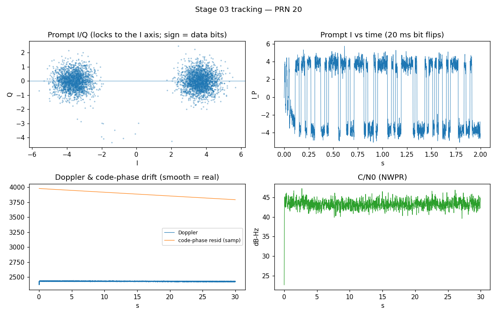

# Stage 03 — Tracking (following each satellite)

**Goal of this stage:** take the coarse `(PRN, code phase, Doppler)` that stage 02
found and **lock onto each satellite**, following its drifting code phase and
carrier for the whole recording. The locked *prompt* correlator, sampled every
1 ms, is the despread signal; grouped into 20 ms bits it becomes the **50 bps
navigation data stream** that stage 04 decodes.

This is where a one-shot detection becomes a sustained measurement. Acquisition
asked "is it there?"; tracking answers "follow it, sample by sample" with two
feedback loops.

---

## The concepts (short version)

### 1. Why we need closed loops
The satellite keeps moving: its Doppler drifts and its code slides continuously
(real range dynamics). A fixed replica would walk off the signal in a fraction of a
second. Tracking runs two loops once per 1 ms code period:

- **Carrier loop — Costas PLL.** Follows carrier phase/Doppler. The discriminator is
  `atan(Q_P / I_P)` (a *Costas* loop): it is blind to the 180° phase flips the
  50 bps data puts on the carrier every 20 ms, so it tracks the carrier without the
  data corrupting it. (Plain `atan2` would react to every bit flip and never lock.)
- **Code loop — carrier-aided DLL.** Early/Prompt/Late correlators at ±0.5 chip; the
  normalized `(E−L)/(E+L)` power discriminator keeps the *prompt* replica centred.
  The code rate is **carrier-aided** — slaved to the measured Doppler
  (`code_rate = 1.023 MHz · (1 + f_carr / L1)`), because code and carrier stretch
  together — so the DLL only has to trim a tiny residual.

Both loop filters use standard 2nd-order coefficients (Kaplan/Borre, damping 0.7);
`calc_loop_coef()` turns a desired loop bandwidth into the filter gains.

### 2. Coherent 1 ms integration
Each epoch correlates one full 1023-chip period (≈4000 samples at 4 MSPS)
coherently → one complex prompt sample `I_P + jQ_P`. At 1 kHz this *is* the despread
baseband: a real bipolar waveform (`Q_P ≈ 0` once locked) whose sign is the data.

### 3. Fine-Doppler pull-in
Acquisition bins are coarse (250 Hz), and a narrow PLL (≈12 Hz) cannot pull in a
residual that large. So stage 02 hands over a **refined Doppler**:
`refine_doppler()` (in `bassanite/acquisition.py`) sweeps ±250 Hz in 10 Hz steps at
the detected code phase, summing the power of 40 one-millisecond correlations, and
writes the result as `fine_doppler_hz` in `scan_results.csv`. Tracking starts its
carrier loop there. Seeds without it (older CSVs, manual `--doppler`) get the same
search, ±200 Hz in 25 Hz steps, inside `track_prn(refine=True)`.

Why 40 ms: each correlation is coherent over only 1 ms, so a few tens of Hz cost
almost nothing and noise moves the peak. Measured against the locked loops' Doppler on
`capture.bin`, 10 ms missed by up to 74 Hz on a weak satellite (PRN 15) and 40 ms by
at most 29 Hz. Until 2026-11-10 the search was a separate 10 ms version here; it
started PRN 7 139 Hz off (−1975 Hz instead of −2114 Hz), and PRN 7 never locked.

### 4. Bit-edge sync → 50 bps
Each nav bit spans exactly 20 ms (20 code periods). We don't know which of the 20
possible 1 ms offsets starts a bit, so `bit_sync()` picks the offset whose aligned
20 ms sums have the most energy (a misaligned grouping straddles sign flips and
cancels). Summing each aligned 20 ms group of `I_P` gives one soft symbol; its sign
is the bit. **Frame/preamble sync is stage 04's job** — stage 03 stops at the bits.

### 5. C/N0 and the lock indicator
`estimate_cn0()` uses the **Narrowband/Wideband Power Ratio (NWPR)** over 20 ms
blocks (bit-aligned so a block never straddles a flip) → dB-Hz. The simple lock
check is `|Q_P| / |I_P|`: well below ~0.3 means the energy sits on I (phase locked).

---

## How to run

```bash
# default: track every DETECTED PRN from stage 02 in the bundled capture (30 s)
python 03_tracking/track.py

# one satellite, short window, no plots (fast)
python 03_tracking/track.py --prn 20 --seconds 5 --no-plot

# a freshly captured / live file (re-run stage 02 on it first to get its CSV)
python 03_tracking/track.py --iq path\to\live.bin --format int8 --fs 4e6

# track a PRN that wasn't auto-detected, with manual seeds
python 03_tracking/track.py --prn 1 --doppler 3750 --code-phase-chips 431.2
```

Key flags: `--from-csv` (stage-02 seeds, default
`results/<recording>/acquisition/scan_results.csv`),
`--all` (track all 32, not just detected), `--prns 5,20,22` (only these detected
PRNs), `--pll-bw`/`--dll-bw`, `--seconds`/`--skip-seconds`, `--out-dir` (default
`results/<recording>/tracking/`, git-ignored), `--no-plot`,
`--progress` (machine-readable `PROGRESS k n prn done_ms total_ms` lines, used by the
web UI's **Track** tab, which runs this script as a separate process).

The loops and helpers named on this page live in
[`../bassanite/tracking.py`](../bassanite/tracking.py); `track.py` is the command
line. The code follows the blocks of the textbook diagram: `correlate()` (carrier
wipe-off and the Early/Prompt/Late correlators), the two discriminators
(`costas_error()`, `dll_error()`), `LoopFilter` (the second-order filter both loops
use, with `calc_loop_coef()`), and `ChannelTracker`, which holds the carrier and code
oscillators and advances one satellite by one code period per `step()`.
`track_prn()` runs a `ChannelTracker` over the recording. `TrackOptions` can switch
on, on purpose, the bugs described under "Implementation notes" below (for the
UI's "break it" switches). `bit_sync()`, `bit_sync_scores()` (the energy of all 20
bit-edge offsets) and `estimate_cn0()` turn the prompt stream into bits and quality
figures.
`track.py` always runs `track_prn(..., detail=True)` and saves the Early/Late
correlators and both discriminator outputs in each npz (this changes no result).
`tracking_summary.csv` gets a `tracking_summary.meta.json` recording which recording
and settings produced it.

> Memory note: `track.py` reads the recording block by block (`bassanite/iq_loader.py::open_iq`
> memory-maps the file and converts only the ~4000 samples each 1 ms step needs), so
> memory does not grow with the recording's length. A 30 s run of 8 satellites peaks at
> about 280 MB of working set, mostly file pages the OS can reclaim. Loading the whole
> window as complex64 used to take about 2 GB.

---

## How stage 03 connects to the rest of the pipeline (the file is the interface)

- **From stage 01:** samples are loaded only through `bassanite/iq_loader.py::load_iq`,
  exactly like stage 02 — so a bundled recording and a fresh live `hackrf_transfer`
  capture are handled identically (just `--iq`/`--format`/`--fs`).
- **From stage 02:** seeds come from `results/<recording>/acquisition/scan_results.csv`. We use the
  sample-rate-independent `code_phase_chips` (converted to samples at our `fs`) and
  `doppler_hz` per detected PRN.
- **To stage 04:** per PRN we write `track_PRN<nn>.npz` (below), plus
  `tracking_summary.csv` and a diagnostic `track_PRN<nn>.png`, into
  `results/<recording>/tracking/`. (`track_PRN20.png` in this folder is the
  `capture.bin` figure shown below.)

### `track_PRN<nn>.npz` contents
| Array | Rate | Meaning |
|---|---|---|
| `i_prompt`, `q_prompt` | 1 kHz | prompt correlator (the despread signal) |
| `doppler_hz` | 1 kHz | tracked carrier Doppler |
| `code_phase_samp` | 1 kHz | absolute (fractional) code-period start sample → pseudoranges in stage 05 |
| `i_early`, `q_early`, `i_late`, `q_late` | 1 kHz | Early/Late correlators (±0.5 chip) |
| `carr_err`, `code_err` | 1 kHz | Costas phase error (cycles) and DLL error (E−L)/(E+L) |
| `nav_symbols`, `nav_bits` | 50 Hz | soft 20 ms sums and hard 0/1 bits |
| `cn0_dbhz`, `lock_cos` | 50 Hz | C/N0 (NWPR) and carrier-lock cosine |
| `prn`, `fs`, `bit_offset`, `ms_per_bit`, … | scalar | metadata |

---

## Result on `capture.bin` (30 s outdoor capture)

Tracking the 8 PRNs stage 02 flagged: **all 8 lock solidly for the full 30 s.**

| PRN | Doppler (Hz) | C/N0 (dB-Hz) | \|Q\|/\|I\| | preambles @300-bit | status |
|----:|-------------:|-------------:|-----------:|:------------------:|:------:|
| 20  |         2425 |         43.3 |       0.11 | 8 | LOCK |
| 22  |         3578 |         41.8 |       0.13 | 8 | LOCK |
| 30  |         −723 |         41.8 |       0.13 | 8 | LOCK |
|  5  |          −96 |         42.3 |       0.12 | 8 | LOCK |
| 14  |         2830 |         40.9 |       0.14 | 8 | LOCK |
| 21  |        −1827 |         38.6 |       0.18 | 8 | LOCK |
| 15  |         3897 |         36.6 |       0.23 | 8 | LOCK |
|  7  |        −2126 |         36.9 |       0.22 | 8 | LOCK (weakest; acq peak/mean 5.4) |

PRN 7 locks since the refined Doppler handover (section 3); before, it started 139 Hz
off and never did. C/N0 of **37–43 dB-Hz** on eight satellites is healthy — this **confirms the
README's revision**: `capture.bin` is *not* weak, and signal strength is not the
blocker (the old `issues/clock_drift/` "≤1 SV / too weak" story is dead).

> 

The PRN 20 panels are the textbook signature: prompt I/Q collapses onto the I axis
(two lobes = the two data polarities), prompt-I shows clean 20 ms bit flips, Doppler
is flat while the **code phase drifts smoothly** (real orbital motion), C/N0 holds
~43 dB-Hz.

---

## Verification — the data is decodable

The test that noise cannot pass: the GPS subframe **preamble `10001011` (or its
inverse) repeats every 300 bits (6 s)**. Checking the emitted `nav_bits`, **all 8
locked PRNs show the preamble paired at exactly 300-bit spacing** (≈5 subframes over
30 s), and all 8 pass the word parity check (IS-GPS-200) on all 48 words that the
alignment check covers. (Before PRN 7 locked, it showed no preamble.) This independently reproduces the
`issues/clock_drift/solution_clean_capture/mini_gps_rx.py` finding and hands stage 04
a clean, frame-syncable bit stream.

```bash
# spot-check the preamble spacing on the saved bits
python -c "import numpy as np,glob; pre=np.array([1,0,0,0,1,0,1,1]); \
[print(f) or (lambda b: print(' paired@300:', sum((i+300) in {j for j in range(len(b)-8) if np.array_equal(b[j:j+8],pre) or np.array_equal(b[j:j+8],1-pre)} for i in range(len(b)-8) if np.array_equal(b[i:i+8],pre) or np.array_equal(b[i:i+8],1-pre))))(np.load(f)['nav_bits'].astype(int)) for f in sorted(glob.glob('results/capture/tracking/track_PRN*.npz'))]"
```

---

## Implementation notes (what makes the loops actually lock)

A few details were decisive — worth recording for anyone touching the loop:

- **Costas, not `atan2`.** The carrier discriminator must fold out the 180° data
  flips (`atan(Q/I)`), or it chases every bit edge and never locks.
- **Exact code-phase bookkeeping (remainder code phase).** The loop processes
  *exactly* enough samples to complete one 1023-chip period each epoch and carries
  the fractional-chip remainder, advancing an **integer** sample pointer. An earlier
  version stepped by the *rounded* samples-per-period; with carrier-aiding a 2.5 kHz
  Doppler makes the true period ≈3999.99 samples, and rounding to 4000 drifts the
  code ~1.5 chips/s → the prompt collapses after ≈0.5 s. Zero-Doppler PRNs (PRN 5)
  survived that bug, which is exactly why it masqueraded as "only PRN 5 works."
- **Carrier phase is advanced with the frequency used for the block**, before the
  loop filter updates it — otherwise the phase reference and the wipe-off disagree
  and the prompt phasor spins.

Each of these can be switched back on purpose with `TrackOptions` (in
`bassanite/tracking.py`), which the Track tab's **Break it** card uses. Re-measured on
PRN 20 and PRN 5 of `capture.bin` (2026-11-10, 5 s from the coarse acquisition
Doppler):

| Switch | Effect |
|---|---|
| `discriminator="atan2"` | never locks: \|Q\|/\|I\| 0.4–0.7, Doppler wandering over more than 100 Hz |
| `integer_period=False` | PRN 20 (2425 Hz) loses lock after ≈0.5 s; PRN 5 (≈ −90 Hz) stays locked while (E−L)/(E+L) creeps from +0.2 to +0.5 over 5 s |
| `carrier_aiding=False` | the 1 Hz DLL lags for ≈2 s ((E−L)/(E+L) −0.4 at the start) and then follows the drift; no loss of lock |
| `phase_before_update=False` | no measurable difference with the current loop |

The UI offers only the first two: the last two change nothing visible in its plots.
